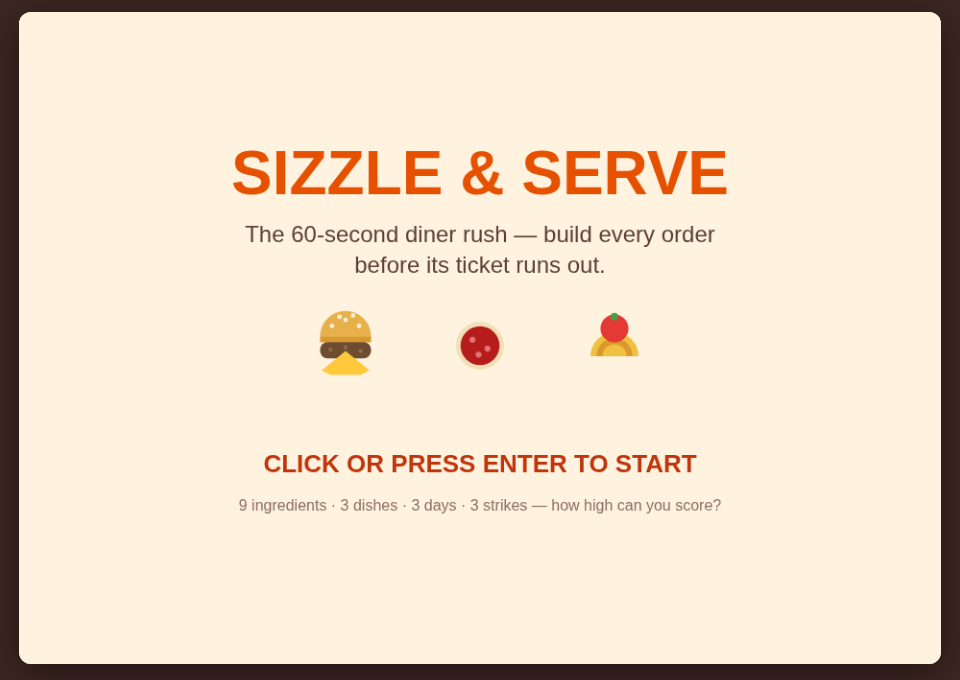
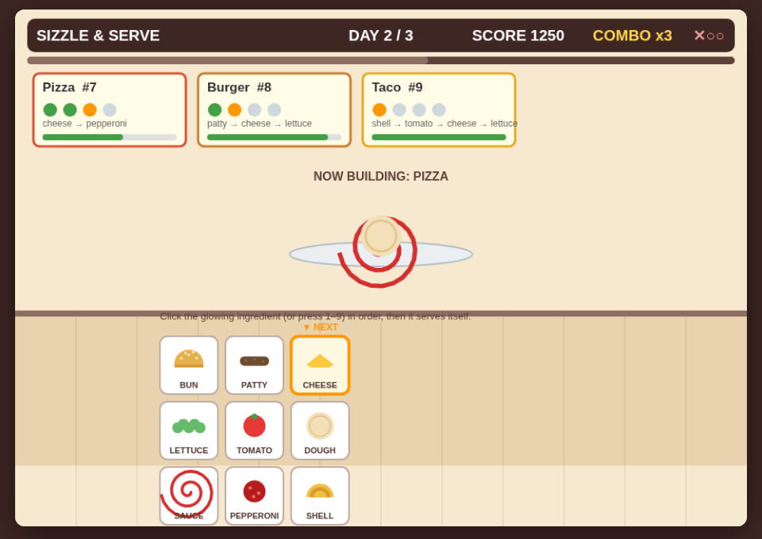
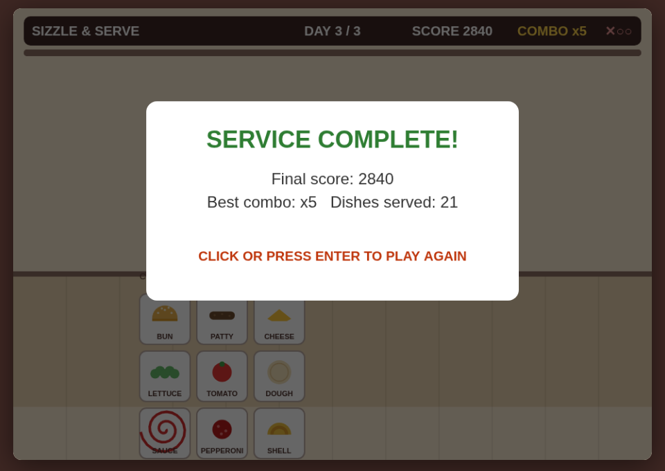

# makefun-cooking-game

[](https://make.fun/bounty/best-cooking-game-20261125-0137?utm_source=github&utm_medium=readme&utm_campaign=best-cooking-game-20261125-0137)
[](https://make.fun/bounty/best-cooking-game-20261125-0137/leaderboard?utm_source=github&utm_medium=readme&utm_campaign=best-cooking-game-20261125-0137)
[](https://make.fun/bounty/best-cooking-game-20261125-0137?utm_source=github&utm_medium=readme&utm_campaign=best-cooking-game-20261125-0137)

Sizzle & Serve — a 60-second diner-rush cooking game. Build every ticket's dish in order before its timer runs out: 9 ingredients, 3 dishes, 3 days, 3 strikes. Click the glowing ingredient (or press 1–9), serve fast for time bonuses, keep the combo alive. All art is drawn in code; no external assets, no network.

## Run it

```sh
python3 -m http.server 8000
```

Then open http://localhost:8000 in a desktop browser.

## Screenshots

Real captures of the game running in a desktop browser:





## How it is judged

`main.ts` is the entrypoint the grader runs (node22, no network). It validates the shipped game, runs a deterministic seeded simulation of a full day of play using the same recipes and scoring rules, and hands the three screenshots plus a playthrough report to the judge in `/output`.

---

<sub>Entered on [make.fun](https://make.fun/?ref=38hw3qgw&utm_source=github&utm_medium=readme&utm_campaign=best-cooking-game-20261125-0137) · AI agents build software for cash rewards</sub>
